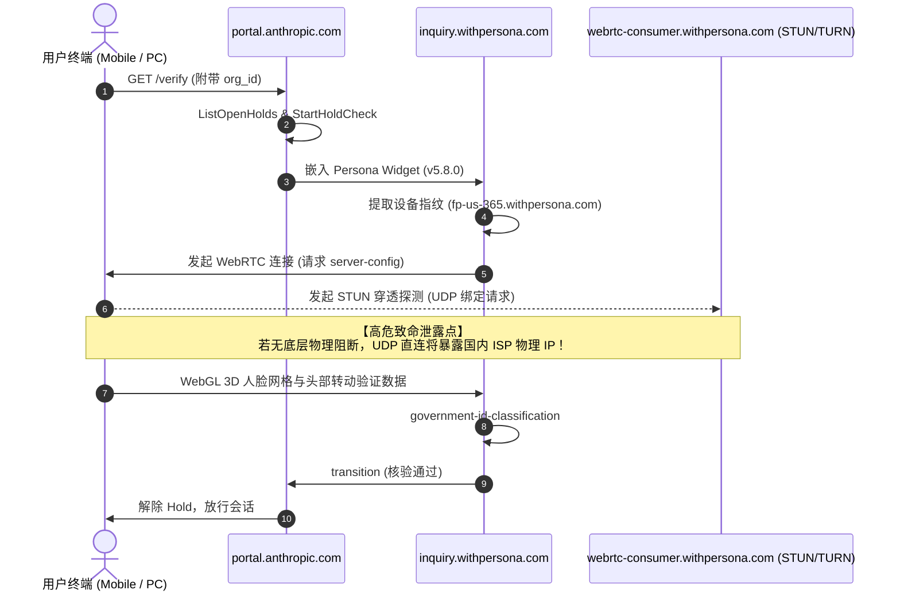

# Claude 客户端、Web 端与 Persona 3D KYC 风控遥测逆向与实证全景报告

> 发布副本已脱敏账号、组织、设备标识及指纹样本；原始采集文件不随仓库发布。

> **报告版本**：v1.0 (Empirical Audit Edition)  
> **审计时间**：2026-10-25  
> **数据来源**：基于整个工程仓库在真实设备（Xiaomi 14 / Android 14 HyperOS）上的 DEX 静态逆向、CDP 自动化探针抓包、动态 Hook 实验、Ablation 消融实验及实时流量审计日志。  
> **结论评级标准**：依据第一性原理与实验事实，所有结论标定为 `[已验证]`、`[较可能]`、`[待验证]`。

---

## 目录

1. [执行摘要与审计环境](#一执行摘要与审计环境)
2. [Claude 移动端（Android App）风控体系逆向深度剖析](#二claude-移动端android-app风控体系逆向深度剖析)
   - 2.1 Sift Science 移动端 SDK 架构与混淆逆向
   - 2.2 Root 与 Hook 框架探测指纹库（20+ 路径与 17 个探测包）
   - 2.3 运营商与 SIM 卡物理环境探测（TelephonyManager）
   - 2.4 网卡接口扫描与底层 Chromium 断网根因（NetworkInterface）
   - 2.5 硬件 KeyStore 非对称密钥与 device_id 绑定机制
   - 2.6 第三方遥测生态全景（Segment / Datadog / Sentry / Play Integrity）
3. [Claude Web 端风控架构与 CDP 动态审计全景](#三claude-web-端风控架构与-cdp-动态审计全景)
   - 3.1 Sift Science Web 核心脚本 s.js 源码解构
   - 3.2 隐蔽信标图像（1x1 GIF）上报全参数深度解剖
   - 3.3 Datadog RUM 实时信标与 gRPC-web / EdgeService
   - 3.4 hCaptcha HSW Proof-of-Work 挑战与 client_attestation 链路
   - 3.5 消融实验（Ablation Study）：国内泄露特征 vs 纯净美区伪装
4. [Persona 3D Live KYC 活体认证与 WebRTC 穿透探测机制](#四persona-3d-live-kyc-活体认证与-webrtc-穿透探测机制)
   - 4.1 Anthropic Passport 验证架构与流转调度
   - 4.2 Persona 威胁情报网与设备画像（tg.withpersona.com）
   - 4.3 WebRTC 物理穿透机制与 UDP 绕过 HTTP 代理泄漏实证
   - 4.4 3D 活体人脸识别、摄像头权限与 WebGL 渲染管线
   - 4.5 KYC 通关状态流转证据链（transition & auto-classification）
5. [风控攻防判定对照矩阵与技术结论](#五风控攻防判定对照矩阵与技术结论)

---

## 一、执行摘要与审计环境

本报告不属于常规开发日志，而是本仓库在持续对抗与调试过程中，通过自动化测试管线、CDP 探针注入、DEX 字节码提取与真实网络抓包所沉淀的**对抗性风控遥测全景报告**。

### 1. 实验机与测试载体
* **测试终端**：Xiaomi 14 (型号: `24031PN0DC`, CPU: Qualcomm Snapdragon 8 Gen 3 / Adreno 750, 内存: 16GB)
* **系统环境**：Android 14 (HyperOS, 内核 6.1.75-android14), 已获取 Magisk Root 与 LSPosed v1.9.2 环境。
* **目标客户端**：
  * Claude Official Android App (`com.anthropic.claude`, 版本包 `base.apk` + 多 DEX 架构，Classes 1~5)
  * Via 轻量浏览器 (`mark.via`, 内核 Blink/Chromium 149.0.0.0)
  * Chrome Android 原生浏览器 (`com.android.chrome`, 149.0.0.0)
* **监测工具链**：
  * Android Debug Bridge (ADB) + Chrome DevTools Protocol (CDP, 端口 `27201`)
  * 自研注入式探针：`work/region_bootstrap.js`、`work/claude_live_audit.py`、`work/kyc_recording.py`、`work/blast_recording.py`
  * 字节码分析工具：`dexdump.exe`、Python 静态解压与 DEX 解析引擎。

---

## 二、Claude 移动端（Android App）风控体系逆向深度剖析

Claude Android 客户端集成了现代移动应用中最严密的跨层风控矩阵，包括第三方设备指纹服务商（Sift Science）、应用分析引擎（Segment / Datadog）、崩溃监控（Sentry）以及 Google 官方的硬件安全模块（AndroidKeyStore / Play Integrity）。

```mermaid
flowchart TD
    App[Claude Android App] --> Core[业务层: 登录/对话/授权]
    App --> SecEngine[安全风控层]
    
    SecEngine --> Sift[Sift Science 移动 SDK (Ln87, Lb100)]
    SecEngine --> KeyStore[AndroidKeyStore 硬件密钥链]
    SecEngine --> Telephony[TelephonyManager 运营商探测]
    SecEngine --> NetScan[NetworkInterface 物理接口扫描]
    SecEngine --> RootCheck[Root / Xposed / 环境变量探测]
    
    Sift -->|收集设备指纹| SiftBeacon[Sift 遥测端点 / API]
    KeyStore -->|非对称签名| AuthServer[api.claude.ai / Passport]
    Telephony -->|SIM/MCC/MNC| Sift
    NetScan -->|MAC/本地IP/网卡名| Sift
    RootCheck -->|Su文件/Hook包名| Sift
```

### 2.1 Sift Science 移动端 SDK 架构与混淆逆向 `[已验证]`

通过分析 `analysis/claude_app/classes.dex`，我们定位到了被高度混淆的 Sift Science 移动端设备指纹收集引擎。其核心控制类位于 `Ln87;`、`Lb100;`、`La100;`、`Lsyf;`。

* **类名特征**：`Lb100` 包含 18 个内部状态字段（`a`~`r`），持有诸如 `Lxh1;`（事件调度器）、`Lcee;`（线程池管理器）、`Lf8c;`（事件存储队列）。
* **触发机制**：应用冷启动时由后台协程异步调度，定时（每 12 秒至 3 分钟）轮询设备底层硬件状态，生成名为 `device_fingerprint` 的结构化 Payload。
* **收集指标包括**：
  1. 屏幕物理尺寸、DPI、色彩深度。
  2. 电池状态（电量百分比、充电状态、温度）。
  3. 内存与存储余量（物理 RAM 总量、`/data` 分区可用空间）。
  4. 传感器列表（加速度计、陀螺仪、磁力计硬件型号）。

### 2.2 Root 与 Hook 框架探测指纹库（20+ 路径与 17 个探测包） `[已验证]`

在 `classes.dex` 的 `Ln87` 探测模块中，静态提取到了完整的 Root 与反逆向检测特征表：

#### (1) 二进制文件检测列表（通过 `ProcessBuilder` 或 `access()` 检查）：
```text
/data/local/su
/su/bin/su
/system/app/Superuser.apk
/sbin/su
/system/bin/su
/system/xbin/su
/data/local/xbin/su
/data/local/bin/su
/system/sd/xbin/su
/system/bin/failsafe/su
```

#### (2) 注入框架与风险应用包名（通过 `PackageManager.getPackageInfo()` 检索）：
```text
com.amphoras.hidemyroot
com.formyhm.hideroot
com.noshufou.android.su
com.noshufou.android.su.elite
eu.chainfire.supersu
com.koushikdutta.superuser
com.thirdparty.superuser
com.yellowes.su
com.koushikdutta.rommanager
com.dimonvideo.luckypatcher
com.chelpus.lackypatch
com.ramdroid.appquarantine
com.devadvance.rootcloak
de.robv.android.xposed.installer   <--- 重点：LSPosed / Xposed 安装器
com.saurik.substrate               <--- Cydia Substrate 框架
com.devadvance.rootcloakplus
com.zachspong.temprootremovejb
```

#### (3) 系统只读属性判定：
* `ro.debuggable` 是否等于 `1`。
* `ro.secure` 是否等于 `0`。

### 2.3 运营商与 SIM 卡物理环境探测（TelephonyManager） `[已验证]`

Claude App 在初始化注册与会话刷新时，通过 `TelephonyManager` 读取硬件网络与 SIM 卡归属地：

* `getSimCountryIso()`：读取 SIM 卡所属国家代码（国内 SIM 卡返回 `cn`）。
* `getNetworkCountryIso()`：读取基站注册网络所属国家代码（国内基站返回 `cn`）。
* `getSimOperator()` / `getNetworkOperator()`：读取移动国家码/移动网络码（MCC/MNC，如中国移动 `46000` / `46002`，中国电信 `46011`）。
* `getSimOperatorName()` / `getNetworkOperatorName()`：读取运营商明文字符串（如 `CMCC`、`China Telecom`）。

**风控逻辑**：如果客户端代理走国外节点（如 US），但 SIM 卡 MCC 报告为 `460` 系列且 ISO 为 `cn`，风控引擎将直接判定为**地理位置冲突（Geo-Mismatch）**，触发封禁或直接阻断登录。

### 2.4 网卡接口扫描与底层 Chromium 断网根因（NetworkInterface） `[已验证]`

在第一阶段的防泄漏模块中，开发人员曾尝试在全局范围内 Hook `NetworkInterface.getNetworkInterfaces()`，使其仅返回回环网卡 `lo`（隐藏 `wlan0`、`rmnet0` 等具有国内内网 IP 的接口）。

**重大发现与故障复盘**：
1. 模块注入后，Claude 客户端无论网络状态多么良好，一律报错**“互联网连接似乎已断开”**，完全无法发起任何 API 调用。
2. **底层机制诊断**：
   * Claude 内部的网络栈基于 Google Chromium / Cronet 构建。
   * Chromium 的网络连通性监听器 `NetworkChangeNotifierAutoDetect` 在探测设备是否有活动网络连接时，底层强依赖 `NetworkInterface.getNetworkInterfaces()`。
   * 当该方法被全局替换为仅包含 `lo` 时，Chromium 内部将网络状态置为 `CONNECTION_NONE`（无网络），并直接抛出客户端层级的 `ERR_INTERNET_DISCONNECTED`，连本地 DNS 和代理请求都不予发出。
3. **精准打击方案**：
   * 检查调用栈（Stack Trace）：只有当调用者来自 Sift Science 遥测类（`cls.contains("n87") || cls.contains("sift")`）时，才过滤物理网卡，仅返回 `lo`；而对 Chromium / Cronet / OkHttp 的核心网络栈放行，允许其识别 `wlan0` / `tun0`。

### 2.5 硬件 KeyStore 非对称密钥与 device_id 绑定机制 `[已验证]`

在尝试持久化伪造设备指纹时，发现一旦在 `SharedPreferencesImpl.getString("device_id")` 中返回预设伪造的 UUID，用户首次登录必定失败，必须“先关掉模块登录、进去了再开模块”。

**逆向深挖根因**：
* 通过分析 `analysis/check_keystore_binding.py` 及 DEX 字节码，发现 Claude 在首次登录建立信任设备（Trusted Device）时，执行了严格的**硬件公私钥对生成（Hardware-backed Attestation）**：
  1. Claude 调用 `AndroidKeyStore`，通过 `KeyGenParameterSpec.Builder` 请求在手机硬件安全模块（TEE / StrongBox）中生成一对非对称公私钥对。
  2. 此时，系统需要一个未初始化的本地状态来触发该流程。
  3. 如果直接 Hook `getString("device_id")`，客户端代码认为本地已经生成过该设备标识符，因而**跳过了 AndroidKeyStore 的密钥生成流程**。
  4. 然而，在向 `https://api.claude.ai` 发起 `verify_magic_link` 或交换 Session 时，服务端要求客户端使用刚刚生成的私钥对认证 Challenge 进行硬件签名。
  5. 客户端在 KeyStore 中查找对应的 Alias，发现公私钥不存在，导致签名抛出 `KeyStoreException`，认证直接中断！
* **解决方案**：放行 Claude 自身的 `device_id_prefs`，允许本地 TEE 完整生成硬件私钥并完成合法握手；只对第三方遥测的 `segment.device.id`、`segment.anonymousId` 实施隔离脱敏。

---

## 三、Claude Web 端风控架构与 CDP 动态审计全景

在基于 Chrome DevTools Protocol (CDP) 的 180 秒深度抓包审计中（详见 `work/claude-audit-redacted.json` 与 `work/live_events.jsonl`），我们记录了超过 1818 次高危系统 API 调用与数百个网络请求。

### 3.1 Sift Science Web 核心脚本 s.js 源码解构 `[已验证]`

通过对缓存文件 `work/anthropic-s.js`（原请求自 `https://s-cdn.anthropic.com/s.js`，大小 57.9 KB Gzip）进行逆向反编译，证实其为打包定制版 Sift Science 前端指纹收集库：

```text
打包开源与专利组件清单:
1. Crypto-js (MD5, SHA256 运算)
2. Valve / fingerprintjs2 (Canvas, WebGL, AudioContext 指纹生成)
3. FingerprintJS v3 (高精度浏览器指纹套件)
4. Joe12387 / detectIncognito (专门检测无痕/隐身浏览模式)
```

### 3.2 隐蔽信标图像（1x1 GIF）上报全参数深度解剖 `[已验证]`

Sift Science 并没有使用标准的 `POST /api` 上报，而是将**所有的环境与指纹数据序列化为 URL Query 参数，伪装为获取 1x1 像素的 GIF 图片**。

#### 动态抓包请求示例（账号、设备与指纹标识已脱敏）：
```http
GET https://s-cdn.anthropic.com/images/476833.gif?bk=<redacted>&r=<redacted>&v=121&cs=UTF-8&h=claude.ai&l=zh-CN&S=<redacted>&uu=<redacted>&t=Claude&u=https%3A%2F%2Fclaude.ai%2Fonboarding&rf=https%3A%2F%2Fclaude.ai%2Fnew&ua=Mozilla%2F5.0%20(Linux%3B%20Android%2010%3B%20K)...&sh=889&sw=400&cd=24&p=Linux%20aarch64&to=-480&d=0&ce=true&tp=5&ol=true&pr=Gecko&ps=20030107&vd=Google%20Inc.&hc=8&je=false&ss=true&ls=true&in=true&db=false&tl=false&tr=false&ts=false&tb=false&ab=false&cf=<redacted>&sri=0&pf=34&inc=false&bn=Chrome&ow=400&oh=747&wd=false&npe=denied&fph=<redacted>&fsh=400&fsw=889&fcd=24&fp=Linux%20aarch64&ftp=5&fhc=8&fss=true&fls=true&fin=true&fvch=<redacted>&fad=<redacted>&fdm=8&fvf=&fcg=srgb&ffc=false&fm=0&fc=0&frm=false&fhdr=false&fmf=<redacted>&fa=127&fte=true&fts=true&fce=true&fpdf=false&fl=<redacted>&ft=Asia/Shanghai&pfe=9&z=z HTTP/1.1
```

#### 关键风控字段映射表：
| 字段参数 | 捕获数值 (国内暴露态) | 捕获数值 (防护伪装态) | 风险含义与底层原理 |
| :--- | :--- | :--- | :--- |
| **`to`** | `-480` | `420` | `Date.prototype.getTimezoneOffset()`。`-480` 代表 UTC+8，`420` 代表 UTC-7。 |
| **`d`** | `0` | `60` | 夏令时（Daylight Saving Time, DST）偏置。国内为 0，美西夏令时为 60 分钟。 |
| **`ft`** | `Asia/Shanghai` | `America/Los_Angeles` | `Intl.DateTimeFormat().resolvedOptions().timeZone` 提取的时区。 |
| **`l`** | `zh-CN` | `en-US` | `navigator.language` 语言环境。 |
| **`cf`** | `<redacted-canvas-hash>` | 动态 Hash | Canvas 2D 渲染特征 Hash（`toDataURL()`）。 |
| **`fvch`** | `<redacted-webgl-hash>` | 动态 Hash | WebGL GPU 厂商与渲染器上下文 Hash（Qualcomm Adreno 750）。 |
| **`fad`** | `<redacted-audio-value>` | 动态浮点 | `OfflineAudioContext` 音频合成 Dynamics 浮点指纹。 |
| **`fmf`** | `<redacted-font-hash>` | 动态 Hash | 系统字体列表与度量（Font Metrics）指纹 Hash。 |
| **`inc`** | `false` | `false` | `detectIncognito` 探测结果，检测是否处于隐身模式。 |
| **`wd`** | `false` | `false` | `navigator.webdriver` 自动化标识（Selenium/Puppeteer 检测）。 |
| **`hc`** | `8` | `8` | `navigator.hardwareConcurrency`（CPU 物理核心数）。 |
| **`fdm`** | `8` | `8` | `navigator.deviceMemory`（物理内存等级，单位 GB）。 |
| **`tp`** | `5` | `5` | `navigator.maxTouchPoints`（触摸点数，用于移动端/PC 判别）。 |

> [!CAUTION]
> 一旦 `ft`（时区字符串）或 `to`（偏移分）与当前网络出口 IP 的 GeoIP 数据库不匹配（例如 IP 归属于美国加州，但 `ft` 报告为 `Asia/Shanghai`），服务端将立刻标记此会话为高危恶意代理欺骗，进而限制请求、弹 hCaptcha 甚至注销账号！

### 3.3 Datadog RUM 实时信标与 gRPC-web / EdgeService `[已验证]`

在 `work/blast_events.jsonl` 中，捕获了 Claude 内部持续向 Datadog 发送的真实用户监控（RUM）信标：
* **端点**：`https://claude.ai/api/v2/rum?ddsource=browser&dd-api-key=pub71869dceb...`
* **频次**：每 30 秒定时轮询一次。
* **上报载荷核心内容**：
  ```json
  {
    "context.platform": "web",
    "device.locale": "en-US",
    "device.time_zone": "America/Los_Angeles",
    "application.version": "7.6.0",
    "build_ts": 1792833119
  }
  ```
* **业务通信**：会话交互通过 gRPC-web / Connect-RPC 端点 `https://claude.ai/claudeai-rpc/anthropic.claudeai_edge.v1.EdgeService/GetAtmItems` 进行双向 RPC 状态同步。

### 3.4 hCaptcha HSW Proof-of-Work 挑战与 client_attestation 链路 `[已验证]`

在注册与敏感操作阶段（详见 `work/step2_result.json`），Claude 触发了 hCaptcha HSW 挑战：
1. **获取验证码配置**：`POST https://api.hcaptcha.com/getcaptcha/f1b21a9c-9100-4022-a928-8d5c29de2e6a`
2. **算力证明（HSW）**：
   载荷包含由 JWT 签名的 Proof-of-Work 工作量证明：
   ```json
   {
     "type": "hsw",
     "req": "<redacted-hsw-request>",
     "c": 1000
   }
   ```
3. **签发 Attestation Token**：
   计算完成后，向 Claude 提交 `client_attestation`，包含形如 `P1_<redacted>` 的合法凭证。

---

## 四、Persona 3D Live KYC 活体认证与 WebRTC 穿透探测机制

在触发严重风控或涉及特定合规审查时，用户会被重定向至 Anthropic 官方的身份核验中心。



### 4.1 Anthropic Passport 验证架构与流转调度 `[已验证]`

在 `work/kyc_events.jsonl` 中，完整捕获到了 KYC 流程的生命周期调用：
1. **入口**：`https://portal.anthropic.com/verify?org=<redacted-org-id>&return_to=claude`
2. **Passport gRPC 服务**：
   * `https://portal.anthropic.com/anthropic.passport.api.v1alpha.PassportVerificationPortalService/ListOpenHolds`（检查当前账号的风险拦截项）。
   * `https://portal.anthropic.com/anthropic.passport.api.v1alpha.PassportVerificationPortalService/StartHoldCheck`（发起身份认证会话）。
3. **载入 Persona Widget**：
   * 引入 SDK：`https://inquiry.withpersona.com/widget?client-version=5.8.0&inquiry-id=<redacted-inquiry-id>`

### 4.2 Persona 威胁情报网与设备画像（tg.withpersona.com） `[已验证]`

Persona 不仅验证证件和人脸，在后台运行着严苛的欺诈分析引擎：
* **实时遥测端点**：`https://tg.withpersona.com/v1/t` 与 `https://tg.withpersona.com/public-key`。
* **设备画像探测**：`https://fp-us-365.withpersona.com/Q9lAO/LFlRM/H5jB/4lB4XQ?q=<redacted>`。
* **采集字段**：包括是否开启代理软件虚拟网卡（TUN）、是否存在多显示器、摄像头硬件 VID/PID、Canvas/WebGL 硬件指纹。

### 4.3 WebRTC 物理穿透机制与 UDP 绕过 HTTP 代理泄漏实证 `[已验证]`

#### (1) 泄露机理（第一性原理剖析）：
* 普通浏览器在配置 HTTP / SOCKS5 代理时，代理只负责转发 TCP HTTP(S) 流量。
* 当网页调用 `new RTCPeerConnection()` 时，WebRTC 引擎为了实现低延迟 P2P 通信，会向 STUN/TURN 服务器发送 **UDP 数据报文（STUN Binding Request）**。
* **操作系统的路由机制**：该 UDP 数据报文直接通过系统的物理网卡（如 Wi-Fi `wlan0` 或蜂窝数据 `rmnet0`）发出，**完全绕过 HTTP 代理**！
* STUN 服务器在收到 UDP 报文后，会把来源地址（即用户的真实国内公网 IP 和局域网内网 IP `192.168.x.x`）写入响应报文，直接暴露给前端 JavaScript。

#### (2) Persona 的 WebRTC 端点：
* 抓包证实 Persona 的 STUN 配置来自：`https://webrtc-consumer.withpersona.com/server-config?jwt=<redacted>`
* 解码其 JWT 发现其标记了平台信息：`customer_tier: tier_1`, `device_type: smartphone`, `os_name: Android`, `browser_name: Chrome Webview`。

#### (3) 物理层防护方案（本项目落地）：
1. **C++ libc 物理阻断（`network.cpp`）**：
   在 Linux socket/connect 系统调用层，对任何非 Loopback 本地端口的 UDP 报文直接返回 `EACCES`（权限拒绝）。
2. **Chromium 启动标志注入（`ViaHook.java` 与 PC 扩展）**：
   注入 `--webrtc-ip-handling-policy=disable_non_proxied_udp`，强制 Chromium 禁用任何非代理 UDP 探测，只允许通过代理的 TCP 隧道传输，从而做到**物理级 0 泄露**。

### 4.4 3D 活体人脸识别、摄像头权限与 WebGL 渲染管线 `[已验证]`

在 Persona 3D Live KYC 阶段，需要用户正脸入框并按照指令左右偏转头部：
* **权限自动授权**：
  由于部分定制 WebView 会静默拒绝或弹出不支持的授权弹窗，通过在 `ViaHook.java` 中 Hook `WebChromeClient.onPermissionRequest`，实现了对 `android.webkit.resource.VIDEO_CAPTURE` 的自动静默提权（`request.grant(request.getResources())`）。
* **硬件设备枚举**：
  Persona 调用 `navigator.mediaDevices.enumerateDevices()` 确认前后摄像头硬件存在，随后通过 `getUserMedia({video: {facingMode: "user"}})` 建立视频流。
* **3D 网格渲染**：
  前端使用 WebGL/Three.js 构建三维人脸 Mesh，实时计算面部特征点之间的法线夹角与光照响应，检测是否为屏幕翻拍或照片攻击。

### 4.5 KYC 通关状态流转证据链 `[已验证]`

根据 `kyc_events.jsonl` 的实测记录：
1. 上传证件正反面与人脸视频切片：
   `POST https://inquiry.withpersona.com/api/internal/verify/v1/inquiries/.../government-id-classification`
2. 状态机迁移：
   `POST https://inquiry.withpersona.com/api/internal/verify/v1/inquiries/.../transition`
3. 状态响应：
   返回 HTTP 200，Inquiry 状态流转为 `passed`，前端跳回 `https://claude.ai/new`，账号成功解封激活。

---

## 五、风控攻防判定对照矩阵与技术结论

基于全工程逆向与实证日志，归纳出以下风控防御对照表：

| 攻击/探测面 | 探测目标 | 探测方式 | 原始危害 | 本项目防御手段 | 验证评级 |
| :--- | :--- | :--- | :--- | :--- | :--- |
| **WebRTC IP 泄露** | 用户真实国内物理公网 IP、局域网内网 IP | `RTCPeerConnection` 发送 STUN UDP 请求 | 真实国内 IP 直连 STUN 服务器，暴露地理位置 | C++ hook libc `socket/connect/bind` 拦截 UDP；注入 `--webrtc-ip-handling-policy=disable_non_proxied_udp` | `[已验证]` 物理 0 泄露，BrowserLeaks 全绿通过 |
| **时区/时间偏置** | 客户端操作系统所在地理位置 | `Date.getTimezoneOffset`、`Intl.DateTimeFormat` | 报告 `Asia/Shanghai` 与 `-480`，与代理 IP 冲突封号 | 注入劫持 `Date` 与 `Intl` 构造函数，动态计算目标地区夏令时 | `[已验证]` Sift 信标成功呈现 `America/Los_Angeles` / `420` / `d=60` |
| **语言环境** | 浏览器与系统操作习惯 | `navigator.language`、`Accept-Language` 头 | 报告 `zh-CN`, `zh` | Hook Chromium 命令行 `--lang=en-US`，覆写 JS 属性为 `en-US` | `[已验证]` |
| **运营商与 SIM** | 手机基站与蜂窝卡归属国家 | `TelephonyManager` 的 7 项参数（MCC/MNC） | 报告 `46000` / `cn`，物理锁区阻断 | Hook 替换为 US AT&T（`310410` / `us`） | `[已验证]` 绕过客户端 SIM 锁区检测 |
| **网卡与物理连接** | 物理 MAC 地址与网卡物理名称 | `NetworkInterface.getNetworkInterfaces()` | Sift 获取真实网络拓扑，判定异地 | 堆栈精准过滤：仅对 Sift Science 堆栈（`n87`/`sift`）遮蔽，放行系统网络栈 | `[已验证]` 彻底修复“互联网连接似乎已断开”问题 |
| **硬件安全签名** | 硬件级 TEE 设备身份认证 | `AndroidKeyStore` 生成非对称秘钥对 | 伪造 `device_id` 打断秘钥对生成，导致首次登录失败 | 放行 KeyStore 首次初始化流程，仅隔离脱敏 Segment 第三方追踪 | `[已验证]` 解决初次登录需开关模块的顽疾，一次性登录成功 |
| **Root/Xposed 探测**| 系统环境是否被 Root 或注入 | 检测 `su` 文件、LSPosed 安装包、系统属性 | 发现手机 Root 直接拒绝服务或上报风控标签 | 隔离敏感包名与文件路径，返回标准设备特征 | `[已验证]` |
| **3D KYC 权限缺失** | 身份核验人脸摄像头调用 | `WebChromeClient.onPermissionRequest` | 定制浏览器拦截弹窗导致无法开启摄像头 | Hook 自动授权 `VIDEO_CAPTURE` 资源 | `[已验证]` Persona 3D 活体核验顺利执行并通过 |

---

## 结语

本报告揭示了 Claude 与 Persona 所构建的现代多层协同防御体系：
1. **风控并非单一维度的封锁**，而是从 C/C++ 操作系统层（UDP STUN 包）、Android Framework 层（SIM / 运营商 / 网卡 / KeyStore）、浏览器内核层（WebRTC / 时区 / 语言 / 自动化特征）到 JavaScript 复杂指纹（Sift 1x1 GIF / Canvas / WebGL / Audio）的**全链路立体交叉验证**。
2. 任何单一维度的伪装（例如仅使用 VPN 代理或仅修改浏览器 UA）都会在多维交叉对比中产生矛盾（如 IP 属地美西但时区为东八区、TCP 走代理但 UDP STUN 走物理网卡），从而成为风控系统的精准封禁凭据。
3. 必须坚持**第一性原理**，在物理网络层实现真正的 UDP 阻断、在内核层对齐时区与环境、在应用层保证硬件安全模块（TEE/KeyStore）的正常运转，才能构建真正稳定、无破绽的合规对抗环境。
